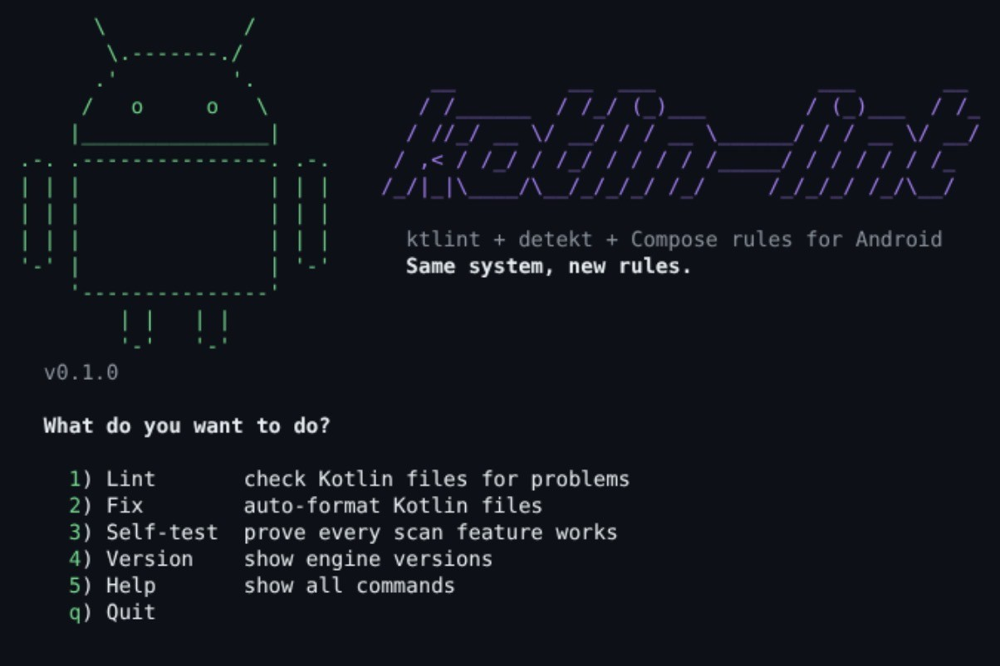

# kotlin_lint

<p align="center">
  
</p>

**One linter for Kotlin Android apps.**

## What it is

`kotlin-lint` bundles three proven Kotlin linters behind one command, with defaults made for Android:

- **ktlint**: formatting and style, set to Android Studio's style
- **detekt**: code smells, complexity and likely bugs
- **Jetpack Compose rules**: Compose mistakes, such as a missing `Modifier` parameter or a `MutableState` passed as a parameter

## Why

Android teams usually wire ktlint, detekt and Compose rules together by hand, then fight false positives:

- `@Composable fun NotesScreen` flagged for its capital letter
- `16.dp` flagged as a magic number
- `@Preview` functions flagged as unused
- the linter disagreeing with Android Studio's *Reformat Code*

`kotlin-lint` ships defaults that already handle all of that. It runs the same way everywhere, like
`actionlint` or `pylint`: same command, same config, same results locally and in CI.

## What it does

- Lints every `*.kt` and `*.kts` file, including Kotlin under `src/main/java` and your `build.gradle.kts` files
- Skips `build/` and `generated/` folders
- Uses Android Studio's formatting style, so *Reformat Code* and the linter agree
- Checks Jetpack Compose code against the Compose API guidelines
- Prints `file:line:col: message [rule]`, then a summary by rule, and exits `1` when it finds problems, so CI fails the build
- Finds likely bugs fast with `kotlin-lint lint --bugs`, and adopts into an existing app with `kotlin-lint baseline`
- Fixes formatting automatically with `kotlin-lint fix`
- Pins and checksum-verifies every engine it downloads

It does not replace **Android Lint**. Keep running `./gradlew lint` for Android-specific checks
(manifest, resources, API levels).

## Use it locally

You need `bash`, `curl` and a JDK 17+. On Windows, use Git Bash.

```console
git clone https://github.com/opensource-for-freedom/kotlin_lint.git
cd your-android-app
../kotlin_lint/bin/kotlin-lint            # logo + menu
../kotlin_lint/bin/kotlin-lint lint       # check the current project
../kotlin_lint/bin/kotlin-lint fix        # auto-format, then show what is left
```

Running it with no command in a terminal opens the menu:

<p align="center">
  
</p>

The output points straight at the problem (from `kotlin-lint lint samples/violations`):

```text
samples/violations/src/main/kotlin/ComposeViolations.kt:10:5: This @Composable function emits content but doesn't have a modifier parameter. [compose:modifier-missing-check]
samples/violations/src/main/kotlin/Violations.kt:9:1: Unexpected indentation (2) (should be 4) [standard:indent]
samples/violations/src/main/kotlin/Violations.kt:11:14: This expression contains a magic number. Consider defining it to a well named constant. [detekt:MagicNumber]
...

By rule (21 rule(s); likely bugs marked *)
        6   ktlint         standard:indent
        3   compose-rules  compose:modifier-missing-check
        1 * compose-rules  compose:mutable-state-param-check
...

31 problem(s), 1 likely bug(s) (see them alone: kotlin-lint lint --bugs samples/violations)
```

Your project's own `.editorconfig` wins for any setting it defines. That includes
`max_line_length`, which both ktlint and detekt follow: set it to `off` and neither reports long
lines. Anything your `.editorconfig` leaves out comes from the Android defaults in
[`.editorconfig`](.editorconfig) and [`config/detekt.yml`](config/detekt.yml).

## Existing app? Start here

On a large app that has never been linted, the first run can report tens of thousands of
findings, most of them formatting. Three tools keep the real bugs from getting buried:

```console
kotlin-lint lint --bugs     # only likely bugs: no formatting
kotlin-lint baseline        # record today's findings in .kotlin-lint-baseline.txt (commit it)
kotlin-lint lint            # from now on: only new findings, so CI fails only on new problems
```

- **Summary by rule.** Every run ends with a count per rule, largest first, with likely bugs
  marked `*`. One screen tells you what you are looking at.
- **`--bugs`.** Shows only the rules that point at real defects: detekt's `potential-bugs`,
  `exceptions` and `coroutines` sets, and the Compose correctness rules, such as stale lambdas
  in effects (`compose:lambda-param-in-effect`) and `mutableStateOf(0)` boxing
  (`compose:mutable-state-autoboxing`). The list is [`config/bug-rules.txt`](config/bug-rules.txt).
- **Baseline.** Known findings are matched by file, rule and message, not line number, so
  editing code above them does not bring them back. `kotlin-lint lint --no-baseline` shows
  everything. Delete entries as you fix them, or rerun `kotlin-lint baseline`.

## Use it in GitHub Actions

Add this workflow to your Android app:

```yaml
# .github/workflows/kotlin-lint.yml
name: Kotlin lint
on: [push, pull_request]

jobs:
  kotlin-lint:
    runs-on: ubuntu-latest
    steps:
      - uses: actions/checkout@v7
      - uses: actions/setup-java@v6
        with:
          distribution: temurin
          java-version: "17"
      - name: Lint Kotlin
        run: |
          git clone --depth 1 https://github.com/opensource-for-freedom/kotlin_lint.git "$RUNNER_TEMP/kotlin_lint"
          "$RUNNER_TEMP/kotlin_lint/bin/kotlin-lint" lint
```

The job fails when problems are found, and the log lists each one as `file:line:col`.
Commit a `.kotlin-lint-baseline.txt` (see [Existing app?](#existing-app-start-here)) and the job fails
only on new findings.
This doesn't need a Gradle build or the Android SDK, so it is much faster than a full Android build.

*Planned:* a one-line `uses: opensource-for-freedom/kotlin_lint@v1` Action with inline PR
annotations. See the [build plan](docs/BUILD_PLAN.md).

## Try it: the self-test

One command checks every scan feature and writes a Markdown report:

```console
./bin/kotlin-lint selftest   # same as ./scripts/selftest.sh; writes selftest-report.md
```

| Part | What it proves |
|---|---|
| Samples | A Jetpack Compose app (`samples/android_app`) and a plain Kotlin app lint clean. Deliberately bad code (`samples/violations`) is flagged by every engine. |
| Scan features | Each case in `tests/cases/` (ktlint formatting, imports, naming, Compose rules, detekt bugs, complexity and style, the Android defaults, `@Suppress`, `build.gradle.kts`, Kotlin under `src/main/java`) produces **exactly** the findings in its `expected.txt`, down to the rule and line. |
| Fix | `fix` output matches a reviewed golden file, and only unfixable findings remain. |
| Tooling | A download with the wrong checksum is refused. A linter that produces no report is an error, never a pass. |
| Command line | The logo (terminal and this README's image), the menu, the `.editorconfig` line length in both engines, the summary by rule, `--bugs`, the baseline, `lint` and `fix` exit codes and output, `NO_COLOR`, and a project outside this repo. |

CI runs the same script on Linux, macOS and Windows and shows the report in the job summary.
After an intended rule change, `UPDATE_EXPECTED=1 ./scripts/selftest.sh` rewrites the
`expected.txt` files. Review that diff before committing. The README logo is rendered from
the CLI's own colored output: after changing `assets/logo.txt`, run `python3 scripts/render-logo.py`.
